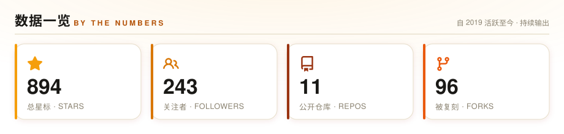
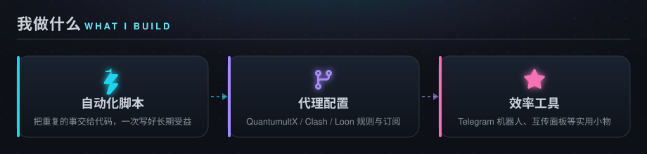
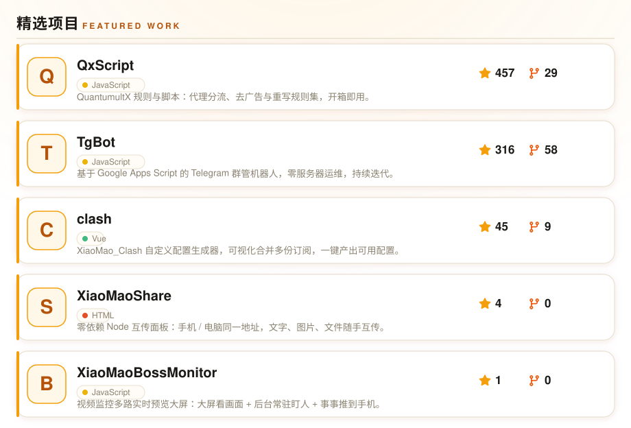
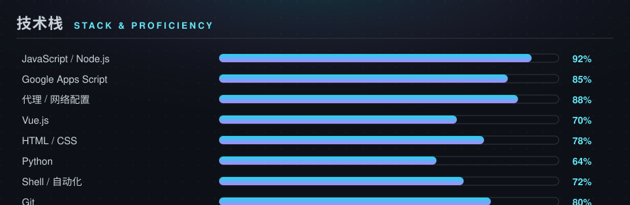

  

  

 

  
  
  

 

---

### 🧭 关于我

> 一个把「重复的事交给代码」奉为信条的折腾型开发者。白天写脚本，晚上调代理，闲下来就做点效率小工具。

- 🔄 &nbsp; 近期更新 **[QxScript](https://github.com/xiaomaoJT/QxScript)**（QuantumultX 规则）、**[TgBot](https://github.com/xiaomaoJT/TgBot)**（Telegram 群管）、**[clash](https://github.com/xiaomaoJT/clash)**（配置生成）、**[XiaoMaoShare](https://github.com/xiaomaoJT/XiaoMaoShare)**（互传面板）、**[XiaoMaoBossMonitor](https://github.com/xiaomaoJT/XiaoMaoBossMonitor)**（监控大屏）
- 🌱 &nbsp; 折腾方向：自动化脚本 / 代理配置 / 效率工具
- 💬 &nbsp; 欢迎通过 [Telegram](https://t.me/ListenToMao) 交流
- ⚡ &nbsp; 信条：**能用脚本解决的，绝不手动做第二遍**

 

---

### 🚀 精选项目

---

### 🛠 技术栈

---

### 📊 GitHub 数据

  
    
  
    
  

---

### 📈 贡献热力图

  

---

### 🐍 贪吃蛇贡献图

  
   
  每日自动更新 · 明暗主题自适应 · Powered by GitHub Actions

---

### 📮 联系我

  
  
  
  

---

  

